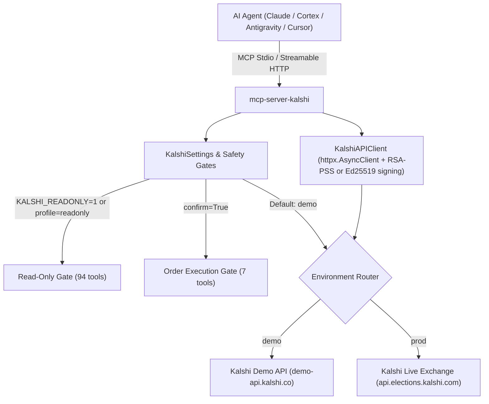

# MCP Server Kalshi

An enterprise MCP server providing AI agents with a first-class interface to [Kalshi](https://kalshi.com) prediction markets. It is built for end-to-end trading: browse markets, research them, read the *exact* settlement rules (including pulling the contract-terms PDFs), manage risk groups, and execute single & batch trades — all through type-safe MCP tools.

This repository is Christian Claudio's fork of [`9crusher/mcp-server-kalshi`](https://github.com/9crusher/mcp-server-kalshi). Install it from this git repository or from `ghcr.io/christianclaudio/mcp-server-kalshi`. Public PyPI and the MCP Registry listing stay with upstream.

---

## 🏗️ System Architecture



---

## 🚀 Highlights (101 Tools)

- **Discovery & Search** — `list_markets`, `get_market`, `list_events`, `get_event`, `list_series`, `get_series`, `get_tags_by_categories`, `get_sports_filters`.
- **Research & Live Feeds** — `get_market_orderbook`, `get_market_orderbooks`, `get_market_candlesticks`, `batch_get_market_candlesticks`, `get_event_candlesticks`, `get_market_trades`, `get_event_live_data`, `get_live_data_batch`, `get_live_data_by_milestone`, `get_live_data` (legacy typed path), `get_game_stats`, `get_weather_index`, `get_weather_index_calibrations`, `get_milestones`, `get_milestone`.
- **Event & Series Metadata** — `get_event_metadata`, `get_series_fee_changes`, `get_event_fee_changes`, `list_multivariate_events`, `get_event_forecast_percentile_history` (authenticated).
- **Structured Targets & Incentives** — `list_structured_targets`, `get_structured_target`, `list_incentive_programs`, `get_incentive_schedules`.
- **On-Request Markets** — `get_weather_point_availability`; `get_concert_cancellation_availability`, `list_concerts`, and `search_concerts` (the concert list and search are authenticated).
- **Deep Contract Rules** — `get_market_rules` consolidates `rules_primary`/`rules_secondary`, early-close conditions, settlement sources, and series prohibitions; `fetch_rules_pdf` downloads and extracts the exact legal contract terms text.
- **Multivariate & Parlays** — `list_multivariate_collections`, `get_multivariate_collection`.
- **Exchange & Status** — `get_exchange_status`, `get_exchange_schedule`, `get_environment`.
- **Historical archive** — `get_historical_cutoff`, historical markets/candlesticks/trades/fills/orders/positions.
- **RFQ batches** — `list_rfq_batches`, `get_rfq_batch`, `get_rfq_batch_best_quotes`, `get_rfq_batch_quotes` (authenticated communications reads). Kalshi lists these endpoints in its OpenAPI spec but hides them from the published docs until RFQ batches launch.
- **Communications** — `get_communications_id`, `list_rfqs`, `get_rfq`, `get_rfq_quote`, `list_quotes`, `get_quote` (deprecated; use `get_rfq_quote`), `list_block_trade_proposals`. `list_quotes`'s `rfq_creator_subtrader_id` filter is FCM members only.
- **Portfolio & Exposure** — `get_balance`, `get_total_resting_order_value` (FCM members only; regular accounts get 403), `get_positions`, `get_fills`, `get_settlements`, `list_deposits`, `list_withdrawals`, `get_credit_history`, `get_order_group`, intra-exchange transfer reads, `get_target_balance_allocation`, `list_api_keys` (`fcm_subtrader_id` is FCM members only), subaccount balance/transfer/netting reads, queue positions, account limits/endpoint costs, and `get_account_api_usage_level_volume_progress`. `get_event_contract_exit_triggers` is hidden from the published docs until take-profit / stop-loss launches. `get_exchange_user_data_timestamp` reports when balance, order, fill, and position reads were last validated.
- **FCM Members Only** — `get_fcm_fills`, `get_fcm_orders`, `get_fcm_positions`, `list_fcm_subtraders`, `get_fcm_event_contract_daily_cap`, `get_fcm_subtrader_blocked_categories`. Direct member accounts are not these endpoints. An API key bound to one subtrader may omit `subtrader_id` where the spec says so.
- **Trading & Execution** — `create_order`, `cancel_order`, `amend_order`, `decrease_order`, `batch_create_orders`, `batch_cancel_orders`, `list_orders`, `get_order`.
- **Risk Management & Order Groups** — `list_order_groups`, `cancel_order_group` (groups that cancel their orders when a rolling 15-second contracts limit is hit). `list_order_groups` keeps its `limit` and `cursor` inputs for compatibility, though Kalshi's OpenAPI spec (v3.34.0) documents only `subaccount` on that endpoint.

---

## 🛡️ Safety by Default

- **Sandbox Default:** The server targets Kalshi's **demo (sandbox)** environment unless `KALSHI_ENV=prod` is explicitly set.
- **Simulation Preview Gating:** Mutating order tools (`create_order`, `amend_order`, `decrease_order`, `cancel_order`, `batch_create_orders`, `batch_cancel_orders`, `cancel_order_group`) require `confirm=true`. Without it, they return a structured simulation **preview** and send nothing.
- **Read-Only Mode:** `KALSHI_READONLY=1` hides every tool whose `readOnlyHint` is not true and `ToolRegistry.get_handler` refuses a write. `KALSHI_MCP_PROFILE=readonly` (or `--profile readonly`) does the same with a `ReadOnlyToolFilter` and does not depend on `KALSHI_READONLY`. The default profile `full` still exposes all 101 tools.
- **Tool Search and Code Mode (opt-in, full profile only):** `KALSHI_MCP_ENABLE_TOOL_SEARCH` / `--enable-tool-search` replaces `tools/list` with `search_tools` and `call_tool` (`KALSHI_MCP_TOOL_SEARCH_BACKEND` `regex` or `bm25`). `KALSHI_MCP_ENABLE_CODE_MODE` / `--enable-code-mode` replaces it with `search`, `get_schema`, and `execute` (install the `code-mode` extra). They are mutually exclusive and are not attached on `readonly`. With `KALSHI_READONLY=1`, `search_tools` / `search` / `get_schema` stay listed because they are read-only, and `call_tool` / `execute` stay listed so a client can still invoke read-only tools. `search_tools` never returns a write tool in that mode. A write tool reached through `call_tool`, `execute`, or a direct call is still refused by `ToolRegistry.get_handler`.
- **Secret Scrubbing:** Private keys (PEM), API keys, request signatures, and Bearer tokens are scrubbed from error logs via `redact_secrets()`.
- **Intuitive Order Pricing:** Exposes intuitive whole **cents** limit pricing and automatically translates buy-NO ⇄ sell-YES orderbook math.

---

## ⚙️ Configuration

| Variable | Default | Purpose |
| :--- | :---: | :--- |
| `KALSHI_ENV` | `demo` | `demo` (sandbox) or `prod` (real money). |
| `KALSHI_API_KEY` / `KALSHI_API_KEY_ID` | _(none)_ | Kalshi API key ID. Required for portfolio and order tools. |
| `KALSHI_PRIVATE_KEY_PATH` | _(none)_ | Path to your RSA or Ed25519 private key `.pem`. Set this or `KALSHI_PRIVATE_KEY`, not both. |
| `KALSHI_PRIVATE_KEY` | _(none)_ | PEM text of that same key, instead of a file. See below. |
| `KALSHI_READONLY` | `0` / `false` | When enabled (`1`), hides non-read-only tools and refuses them in the handler, including a write reached through Tool Search or Code Mode. |
| `KALSHI_MCP_PROFILE` | `full` | `full` (all 101 tools) or `readonly` (readOnlyHint tools only). `--profile` overrides. |
| `KALSHI_MCP_ENABLE_TOOL_SEARCH` | `0` / `false` | On `full` only, replace `tools/list` with `search_tools` + `call_tool`. |
| `KALSHI_MCP_TOOL_SEARCH_BACKEND` | `regex` | `regex` or `bm25`. |
| `KALSHI_MCP_ENABLE_CODE_MODE` | `0` / `false` | On `full` only, replace `tools/list` with `search`, `get_schema`, and `execute`. Needs the `code-mode` extra. Mutually exclusive with Tool Search. |
| `BASE_URL` | _(derived)_ | Optional REST override. Only `https://demo-api.kalshi.co/trade-api/v2`, `https://api.elections.kalshi.com/trade-api/v2`, or Kalshi's dedicated hosts: production `https://external-api.kalshi.com/trade-api/v2` and demo `https://external-api.demo.kalshi.co/trade-api/v2` ([changelog, May 7, 2026](https://docs.kalshi.com/changelog)). With no override, the server keeps using the shared hosts (`api.elections.kalshi.com` for `KALSHI_ENV=prod`, `demo-api.kalshi.co` for demo), which Kalshi still supports. The dedicated demo host reports as DEMO. |

### Private key

Set **one** of these for portfolio and order tools. Public market and rules tools do not need either.

- `KALSHI_PRIVATE_KEY_PATH` is a filesystem path to the PEM file (RSA or Ed25519).
- `KALSHI_PRIVATE_KEY` is the PEM text itself. A multiline value is accepted. A single line that uses the two-character `\n` escape, or the four-character `\r\n` escape, is accepted too; those are the forms most secret stores emit. A blank value counts as unset.

Setting both is a configuration error. The process stops before it loads a key, and the error names the two variables only. Prefer your platform secret store (or a mounted file) over a shell command, shell history, or a committed env file. The key text is not written to logs, error messages, or tool results. `.env-example` has a commented placeholder and no key material.

---

## 📦 Client Configuration

### Claude Desktop (`claude_desktop_config.json`)
```json
{
  "mcpServers": {
    "kalshi": {
      "command": "uvx",
      "args": ["--from", "git+https://github.com/christianclaudio/mcp-server-kalshi", "mcp-server-kalshi"],
      "env": {
        "KALSHI_ENV": "demo",
        "KALSHI_API_KEY": "<YOUR_KALSHI_API_KEY>",
        "KALSHI_PRIVATE_KEY_PATH": "/path/to/kalshi-rsa.pem"
      }
    }
  }
}
```

### Google Antigravity & Gemini CLI (`~/.gemini/antigravity-cli/mcp_config.json`)
```json
{
  "mcpServers": {
    "kalshi": {
      "command": "uvx",
      "args": ["--from", "git+https://github.com/christianclaudio/mcp-server-kalshi", "mcp-server-kalshi"],
      "env": {
        "KALSHI_ENV": "demo",
        "KALSHI_API_KEY": "<YOUR_KALSHI_API_KEY>",
        "KALSHI_PRIVATE_KEY_PATH": "/path/to/kalshi-rsa.pem"
      },
      "lazy": true
    }
  }
}
```

### Snowflake Cortex (`~/.snowflake/cortex/mcp.json`)
```json
{
  "mcpServers": {
    "kalshi": {
      "command": "uvx",
      "args": ["--from", "git+https://github.com/christianclaudio/mcp-server-kalshi", "mcp-server-kalshi"],
      "env": {
        "KALSHI_ENV": "demo",
        "KALSHI_API_KEY": "<YOUR_KALSHI_API_KEY>",
        "KALSHI_PRIVATE_KEY_PATH": "/path/to/kalshi-rsa.pem"
      },
      "lazy": true
    }
  }
}
```

### Cursor & VS Code (Cline / Roo Code)
Add to `.cursor/mcp.json` or `cline_mcp_settings.json`:
```json
{
  "mcpServers": {
    "kalshi": {
      "command": "uvx",
      "args": ["--from", "git+https://github.com/christianclaudio/mcp-server-kalshi", "mcp-server-kalshi"],
      "env": {
        "KALSHI_ENV": "demo",
        "KALSHI_API_KEY": "<YOUR_KALSHI_API_KEY>",
        "KALSHI_PRIVATE_KEY_PATH": "/path/to/kalshi-rsa.pem"
      }
    }
  }
}
```

### Local HTTP / Streamable HTTP Transport
Launch the FastMCP server over modern Streamable HTTP:
```bash
python -m mcp_server_kalshi.server --transport streamable-http --host 127.0.0.1 --port 8000
```

Connect your HTTP client or proxy to `http://127.0.0.1:8000/mcp`.

**HTTP authentication.** Set `KALSHI_MCP_AUTH_TOKEN` to require `Authorization: Bearer <token>` on every HTTP request; a missing or wrong token gets `401`. The token is stripped, and a blank value counts as unset. It is attached when the server is built, so `mcp-server-kalshi`, `fastmcp run` and an ASGI host mounting `mcp.http_app()` (or `mcp.streamable_http_app()`) all enforce it when it is set. stdio never uses it.

With no token, `mcp-server-kalshi` still starts an HTTP bind to `127.0.0.1`, `::1` or `localhost`, unauthenticated, and logs a warning. A tokenless bind to any other host exits with code 2. Set the token, bind to localhost, or set `KALSHI_MCP_ALLOW_UNAUTHENTICATED_BIND` to `1`, `true`, `yes` or `on` to accept an unauthenticated public bind (any other value refuses). Other entry points get the token but not the localhost check: `fastmcp run` and `http_app()` do not go through `mcp-server-kalshi`'s `main()`, so a bind to `0.0.0.0` with no token there is not refused and serves without authentication. The host or its process manager owns the bind address, so set `KALSHI_MCP_AUTH_TOKEN` there.

To serve the image over HTTP, pass credentials and the token from your environment or an env file, never on the command line:

```bash
# export KALSHI_ENV, KALSHI_API_KEY and KALSHI_MCP_AUTH_TOKEN first, or use --env-file .env
docker run --rm -p 8000:8000 \
  -v /path/to/kalshi-key.pem:/home/mcp/kalshi-key.pem:ro \
  -e KALSHI_ENV -e KALSHI_API_KEY -e KALSHI_MCP_AUTH_TOKEN \
  -e KALSHI_PRIVATE_KEY_PATH=/home/mcp/kalshi-key.pem \
  ghcr.io/christianclaudio/mcp-server-kalshi \
  --transport streamable-http --host 0.0.0.0 --allowed-host mcp.example.com
```

Replace `mcp.example.com` with the host name clients use to reach the server.

**Known limits.**
* Only `mcp-server-kalshi` refuses a tokenless public bind (exit code 2). `fastmcp run` and `mcp.http_app()` enforce the token when it is set but do not refuse a tokenless public bind.
* A token changed after the server is built is not picked up; restart the server.
* In the default (stateful) HTTP mode, a session idle for 30 minutes expires: its next request gets HTTP 404 and the client must start a new session. Change this with FastMCP's `session_idle_timeout` (on `http_app()`) or `FASTMCP_HTTP_SESSION_IDLE_TIMEOUT` (seconds, or `none` to never expire); see the [FastMCP 4.1.0 release](https://github.com/PrefectHQ/fastmcp/releases/tag/v4.1.0) and [#5229](https://github.com/PrefectHQ/fastmcp/pull/5229).

### Docker
```json
{
  "mcpServers": {
    "kalshi": {
      "command": "docker",
      "args": ["run", "--rm", "-i",
        "-v", "/path/to/kalshi-key.pem:/home/mcp/kalshi-key.pem:ro",
        "-e", "KALSHI_ENV", "-e", "KALSHI_API_KEY",
        "-e", "KALSHI_PRIVATE_KEY_PATH=/home/mcp/kalshi-key.pem",
        "ghcr.io/christianclaudio/mcp-server-kalshi:latest"
      ]
    }
  }
}
```

The image runs as the non-root `mcp` user, so the mounted key file must be readable by that user.

---

## 🧪 Verification & Local Development

```bash
# 1. Install dependencies
uv sync --locked --all-extras

# 2. Run unit & offline tests (100% coverage enforced)
uv run pytest --cov=src/mcp_server_kalshi --cov-fail-under=100

# 3. Static type analysis & linting
uv run mypy --strict
uv run ruff check .
uv run black --check src tests

# 4. Tool contract, drift & protocol conformance validation
uv run python scripts/check_tool_contract.py
uv run python scripts/check_openapi_drift.py
./scripts/check_conformance.sh
```

---

## 📚 Documentation & Guides

- 🛡️ [Security Policy & Guidelines](SECURITY.md)
- 🤝 [Contributing Guidelines](CONTRIBUTING.md)
- 🧪 [Testing & Verification Invariants](TESTING.md)
- 📝 [Changelog (GitHub Releases)](https://github.com/christianclaudio/mcp-server-kalshi/releases)
